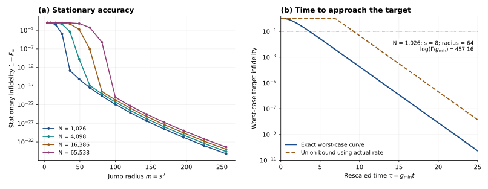

# Fermi-Sea Reservoir Locality

**How far must a stationary Gaussian reservoir reach to prepare an entire critical Fermi sea with fixed accuracy?**

For a periodic hopping chain with one fermionic mode per site, the minimum common range of the quadratic Hamiltonian and linear Lindblad jumps grows as

```math
\boxed{R_{\min}(N,F_0)=\Theta_{F_0}\!\left((\log N)^2\right)}
```

at every fixed global overlap $`F_0\in(0,1)`$, along the sizes $`N=4M+2`$. The generator is time independent and invariant under translation by one site. Pairing is allowed, the stationary state is unique, and convergence is required from every physical initial state. Both coherent and dissipative range are counted.

The lower bound permits arbitrary finite coefficients, any finite number of translated jump families and unlimited waiting. A matching construction uses two gain/loss families, bounded occupation rates and explicitly finite coefficient precision. Its convergence is slow, so the spatial optimum does not by itself provide a fast preparation method.

## Results and scope

| Question | Result | Scientific account |
|---|---|---|
| What spatial range is necessary? | An explicit finite-size rational-degree bound implies the square-logarithmic common-radius lower bound, including general pairing. | [Range lower bound](science/range_lower_bound.md) and [Gaussian stationarity](science/gaussian_stationarity.md) |
| Can that range be attained? | Positive gain and loss filters with geometrically spaced polynomial roots attain radius $`O(\log^2(N/\epsilon))`$. | [Reservoir construction](science/reservoir_construction.md) |
| Are exact real coefficients necessary? | $`O(\log^3(N/\epsilon))`$ fractional bits per independent normalized coefficient suffice; the coefficient description uses $`O(\log^5(N/\epsilon))`$ bits. | [Finite precision](science/reservoir_construction.md#dyadic-rounding-theorem) |
| How long does this realization take? | At fixed requested infidelity, its actual worst-case preparation time has $`\log(\Gamma t_{\mathrm{worst}})=(1+o(1))(\log N)^3`$, including the rounded realization. | [Preparation costs](science/preparation_costs.md) |

Here $`F=\langle\mathrm{FS}_N|\rho|\mathrm{FS}_N\rangle`$ is the squared pure-target fidelity, $`\epsilon`$ is a requested infidelity, and $`\Gamma`$ bounds the momentum occupation rates. The spatial theorem concerns the attracting stationary state. It does not optimize preparation time or coefficient precision over all reservoirs.



**Illustration.** Left: stationary infidelity of the ideal geometric-root filters at several finite sizes. Right: the exact worst-case approach to the target for one such filter, compared with the occupation union bound using its actual minimum rate. The time axis is rescaled by that very small rate. These curves illustrate the supplied construction; they are not an optimized time versus range frontier. [Data and plotting command](verification/README.md#figures).

## Read the scientific argument

The [model](science/model.md) is the authoritative entry point for the assumptions, fidelity convention and main theorem.

1. **[Model and spatial threshold](science/model.md):** define the target, allowed generators and charged resources.
2. **[Gaussian stationarity](science/gaussian_stationarity.md):** derive rational occupations with controlled degree, including asymmetric momentum populations and pairing; handle the stability exception using vanishing onsite noise.
3. **[Finite range lower bound](science/range_lower_bound.md):** convert global fidelity into an aggregate error budget and prove the discrete root-potential inequality.
4. **[Explicit reservoir and precision](science/reservoir_construction.md):** construct the matching filters and show how finite dyadic coefficients preserve their accuracy and damping.
5. **[Convergence and resource accounting](science/preparation_costs.md):** derive preparation bounds for arbitrary physical initial states and identify the construction's actual slow scale.
6. **[Physical interpretation](science/interpretation.md):** connect the two logarithms, whole-state accuracy and the separate costs of range, time and precision.

For context, start with the [related-work comparison](references/RELATED_WORK.md). It distinguishes the present finite-accuracy optimization from exact Fermi-sea stabilization, Gaussian matrix product states and existing rational approximation results. The [bibliography](references/references.bib) records the primary sources.

The locality convention is fermionic. A Jordan–Wigner representation can attach spin strings to local fermionic operators, so this theorem is not a statement about the range of spin-local reservoirs. Persistent auxiliary modes, enlarged unit cells, feedback, nonlinear jumps and time-dependent control are outside the stated model.

## Study the project

The educational anchor is Heinz-Peter Breuer and Francesco Petruccione, *The Theory of Open Quantum Systems* (2002; first paperback 2007). Its master-equation framework supplies the starting point for understanding how a reservoir changes a state and selects its stationary limit.

Start with the [anchor bridge](learning/ANCHOR_BRIDGE.md), which translates that framework into the fermionic model and identifies the additional arguments developed here. Then follow the [30-milestone map](learning/MILESTONES.md), progressing from the physical ingredients to the converse, construction and overall resource law. The proof pages remain the direct route to technical details.

## Reproduce the finite checks

From the repository root, with Python 3.12:

```bash
python3 -m venv .venv
source .venv/bin/activate
python -m pip install -r verification/requirements.txt
python verification/run_all.py
python verification/make_figures.py
```

The main runner checks the root-deletion estimate, ideal filter inequalities, covariance conventions, finite coefficient rounding and the exact occupation dynamics of a non-Gaussian initial state. It exits unsuccessfully if a checked inequality or tolerance fails and writes [verification_summary.json](verification/verification_summary.json). The [verification guide](verification/README.md) explains the individual checks, expected outputs and numerical limits. Finite diagnostics support the delicate conventions and realizations; the universal theorem is established by the written proofs.

## Purpose and contact

This repository serves as a record of the work and a guide for the author’s self-directed learning. For discussion or potential collaboration, please contact Ruge Lin at [gogoko699@gmail.com](mailto:gogoko699@gmail.com).

The repository is distributed under the [MIT license](LICENSE).

